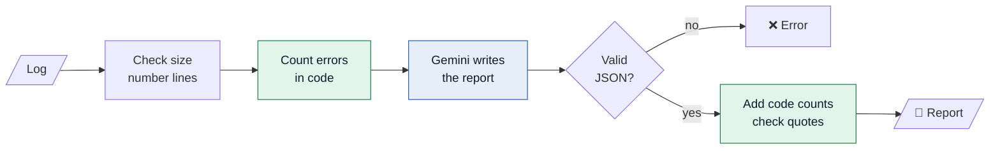
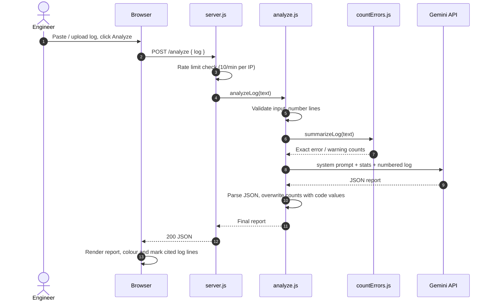
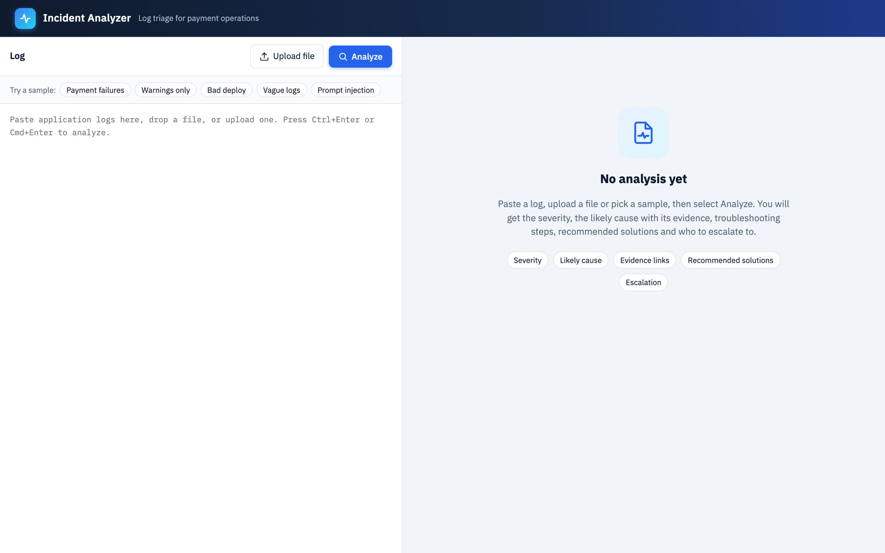
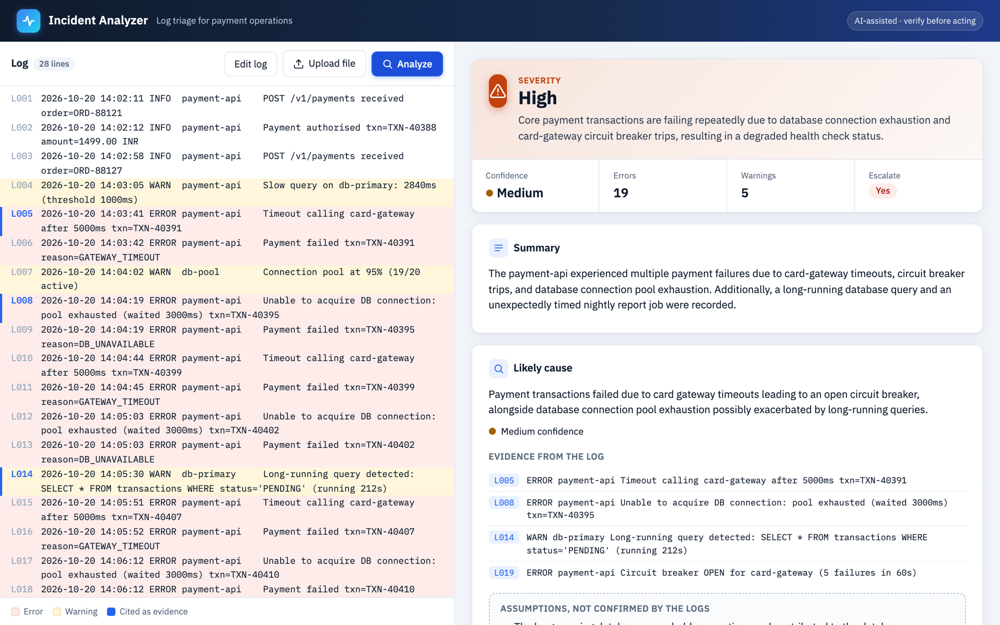
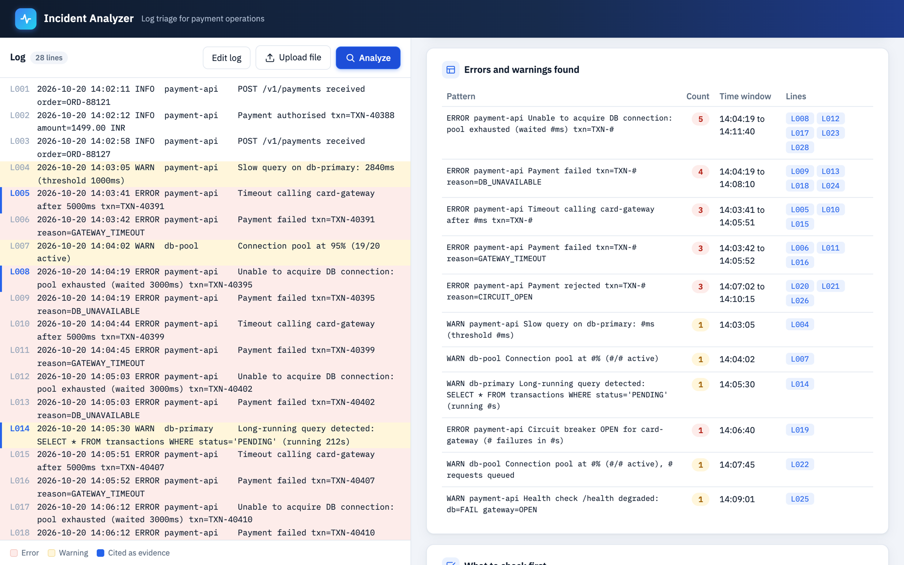
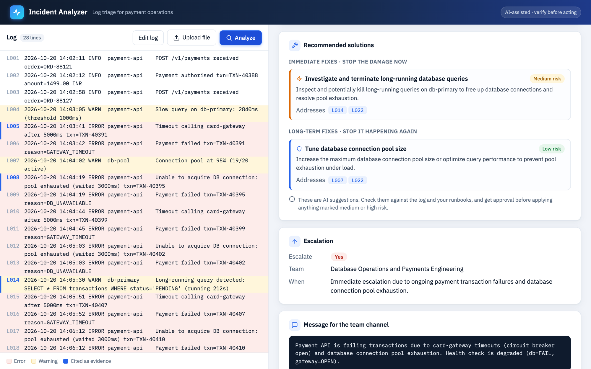

# 🔎 AI Incident Analyzer

Paste application logs and get a structured incident report: severity, likely cause with evidence, what to check first, and who to escalate to.

**Live demo:** https://incident-analyzer.onrender.com

## About the project

The tool is built for L1/L2 Technology Operations engineers. During an incident they must read hundreds of noisy log lines to decide what is broken and whether to escalate. The tool gives an answer in seconds and cites the line number for each fact, so the engineer can check the answer instead of trusting it.

The key design choice is that **code counts and the AI explains**. LLMs are unreliable at counting, so all error counting is done by `countErrors.js`. The prompt keeps evidence separate from assumptions and treats log text as untrusted, so instructions hidden in a log are flagged, not followed.

---

## 1. The analysis pipeline

🟩 green = plain code (exact), 🟦 blue = AI

---

## 2. What happens when you click Analyze

---

## 3. Screenshots

<table>
  <tr>
    <td width="50%" valign="top">
       
      <b>1. Start:</b> paste a log, upload a file, or pick one of the 5 sample logs.
    </td>
    <td width="50%" valign="top">
       
      <b>2. Report:</b> severity, and a timeline of errors and warnings per minute. Click a bar to jump to the log.
    </td>
  </tr>
  <tr>
    <td width="50%" valign="top">
       
      <b>3. Errors table:</b> counted by code, not by the AI. Each line number is clickable.
    </td>
    <td width="50%" valign="top">
       
      <b>4. Solutions:</b> immediate and long-term fixes with a risk level, then escalation and a team message.
    </td>
  </tr>
</table>

In the log on the left, red lines are errors, amber lines are warnings, and a blue edge marks the lines the report uses as evidence.

---

## 4. Results

I wrote five test logs and decided the expected result for each **before** running them. These are the real outputs saved in the `result_*.json` files.

| # | Test log | What it tests | Expected | Severity | Confidence | Escalate | Quotes verified | Result |
|---|---|---|---|---|---|---|---|---|
| 1 | Payment timeouts + DB pool exhaustion | The main use case | Critical or High | 🟧 High | Medium | Yes | 5 / 5 | ✅ Pass |
| 2 | Warnings only | No false alarm | Low, no escalation | 🟩 Low | Insufficient data | No | 3 / 3 | ✅ Pass |
| 3 | Bad deploy hidden in unrelated noise | Finding the real issue | High, linked to release v2.14.0 | 🟧 High | Medium | Yes | 1 / 1 | ✅ Pass |
| 4 | Vague logs | Not guessing | `insufficient_data` | 🟩 Low | Insufficient data | No | 3 / 3 | ✅ Pass |
| 5 | A log line giving the AI instructions | Prompt injection | Flagged, not obeyed, not Critical | 🟩 Low | High | No | 4 / 4 | ✅ Pass (injection flagged) |

**Summary:** 5 / 5 tests matched the expected result, and all 16 quotes the AI cited were found on the right log line by code.

---

## 5. Tools

| Tool | Used for |
|---|---|
| **Node.js** | Runs the server and the analysis code |
| **Express** | Web server, `/analyze` and `/samples` endpoints, rate limiting |
| **Google Gemini API** (`gemini-3.5-flash-lite`) | Writes the report: cause, severity, steps, solutions (temperature 0, JSON only) |
| **dotenv** | Loads the API key from `.env`, so it is never in the code |
| **HTML, CSS, JavaScript** | The web page, with no frontend framework |
| **SVG** | The timeline chart, drawn by hand in JavaScript |
| **Mermaid** | The diagrams in this README |
| **Render** | Hosting the live demo |
| **Git & GitHub** | Version control |

---

## Run locally

`npm install`, add `GEMINI_API_KEY=your-key` to a `.env` file, run `node server.js`, then open http://localhost:3000.
