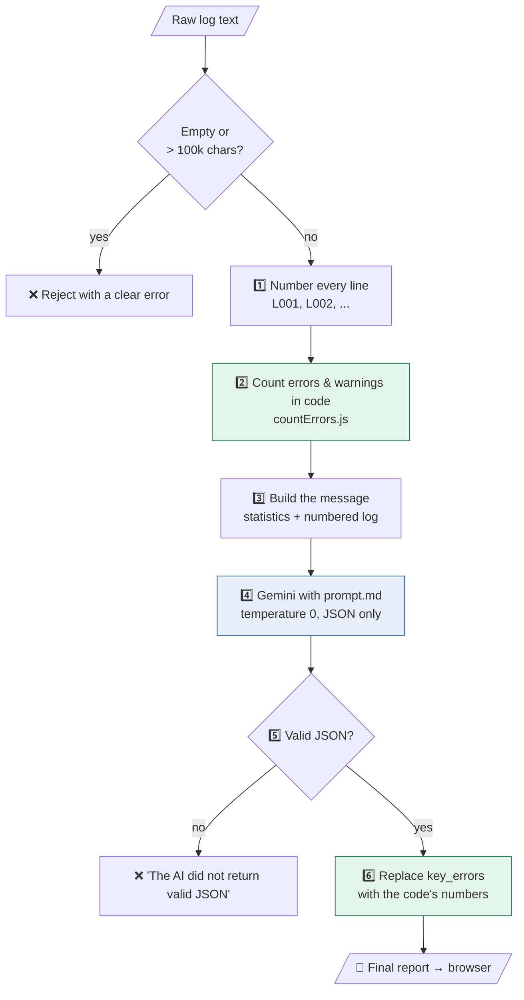
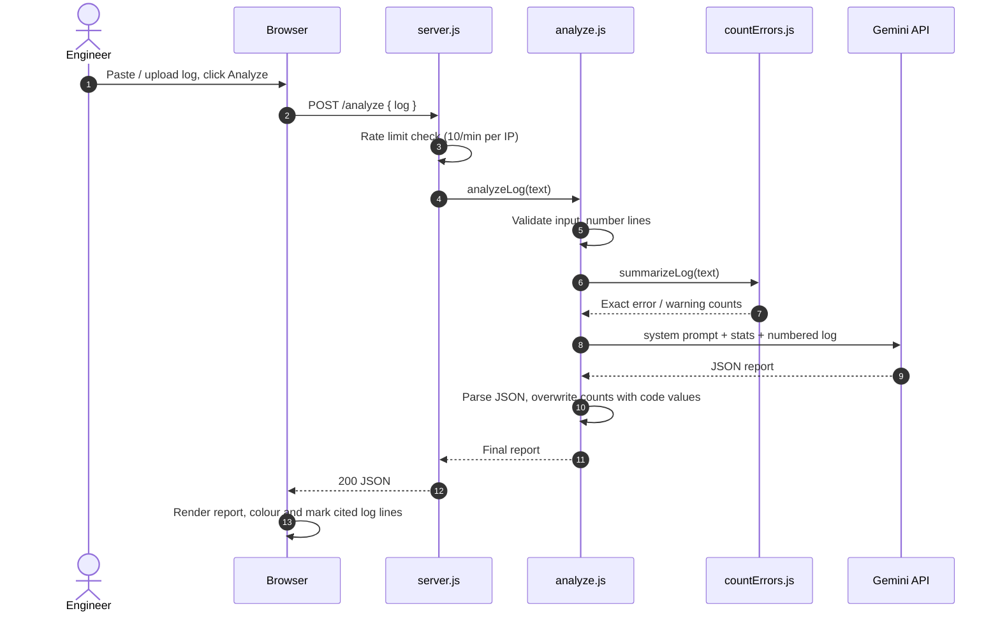
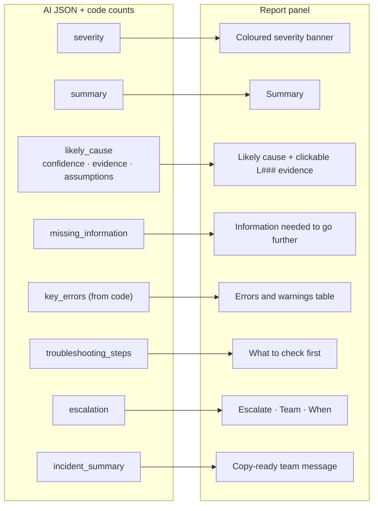

# 🔎 AI Incident Analyzer

Paste application logs and get a structured incident report: severity, likely cause with evidence, what to check first, and who to escalate to.

**Live demo:** https://incident-analyzer.onrender.com

---

## 1. The analysis pipeline

🟩 green = plain code (exact), 🟦 blue = AI

---

## 2. What happens when you click Analyze

The log is shown with line numbers. Red lines are errors, amber lines are warnings, and a blue edge marks the lines the report uses as evidence:

---

## 3. From JSON to screen

**Errors and warnings table:** counted by code, not by the AI:

**Troubleshooting steps, escalation and team message:**

---

## About the project

The tool is built for L1/L2 Technology Operations engineers. During an incident they must read hundreds of noisy log lines to decide what is broken and whether to escalate. The tool gives an answer in seconds and cites the line number for each fact, so the engineer can check the answer instead of trusting it.

The key design choice is that **code counts and the AI explains**. LLMs are unreliable at counting, so all error counting is done by `countErrors.js`. The prompt keeps evidence separate from assumptions and treats log text as untrusted, so instructions hidden in a log are flagged, not followed.

**Tech stack:** Node.js, Express, plain HTML/CSS/JS, Google Gemini API, hosted on Render.

**Run locally:** `npm install`, add `GEMINI_API_KEY=your-key` to a `.env` file, run `node server.js`, then open http://localhost:3000.
